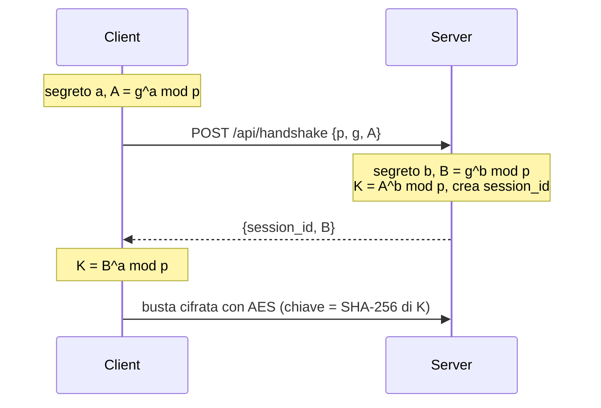

# FrigoTrack – telemetria sicura (C#, .NET 8)

Un solo progetto, due modalità. Apri `FrigoTrack.csproj` con Visual Studio, oppure da terminale:

```
dotnet run server     (terminale 1)
dotnet run client     (terminale 2)
```

## File

| File | Cosa fa |
|---|---|
| `Program.cs` | sceglie server / client |
| `Crypto.cs` | Diffie-Hellman (`ModPow`) e cifratura AES-GCM |
| `Validator.cs` | controlla un messaggio con uno schema |
| `Server.cs` | server HTTP e i 4 endpoint |
| `Client.cs` | i 3 sensori |
| `schemas/` | uno schema per ogni tipo di messaggio |

## Protocollo

| Endpoint | Richiesta | Risposta |
|---|---|---|
| `POST /api/handshake` | `p`, `g`, `client_public` (chiaro) | `session_id`, `server_public` |
| `POST /api/telemetry` | busta con la misura | busta con ack + allarme |
| `POST /api/readings` | busta con sensore e intervallo | busta con le misure |
| `POST /api/close` | busta `{"action":"close"}` | busta `{"status":"closed"}` |

Codici: 200 ok · 400 messaggio o busta non valida · 401 sessione inesistente · 404 endpoint inesistente.

### Handshake



### Busta

`{ "session_id": "a3f9c2e1", "ciphertext": "...Base64...", "tag": "...Base64..." }`

Il server fa sempre: **busta → sessione → decifra → valida con lo schema**. Se la decifratura o il tag falliscono: 400.

### Allarmi

food 0…4 °C · pharma 2…8 °C · frozen -25…-18 °C. Fuori intervallo l'ack ha `"alarm": true`.

## Schemi

`handshake-request`, `handshake-response`, `envelope`, `telemetry`, `ack`, `readings-request`,
`readings-response`, `close-request`, `error`. L'errore dice il campo sbagliato, ad esempio
`{"status":400,"message":"/temperature_c: ... maximum ..."}`.
